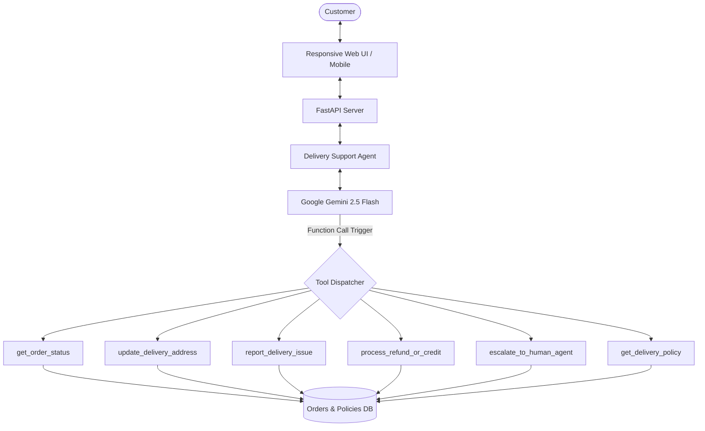

# 🛵 SwiftDrop — GenAI Delivery Support Chatbot

An intelligent, production-ready Customer Delivery Support Chatbot built with **Python**, **FastAPI**, and **Google Gemini** using **Native Function Calling**. Designed for seamless deployment on **Render.com** or any cloud container platform.

---

## 🌟 Key Features

- **Native Gemini Function Calling**: The LLM dynamically invokes real backend tools based on customer intent:
  - `get_order_status`: Real-time order status, ETA, driver details, and current location.
  - `update_delivery_address`: Modify drop-off notes or address (subject to delivery state policy).
  - `report_delivery_issue`: Register tickets for damaged food, cold items, or missing items.
  - `process_refund_or_credit`: Instant wallet compensation or card refund processing.
  - `escalate_to_human_agent`: Graceful handoff to human support with queue management.
  - `get_delivery_policy`: Clear knowledge extraction for cancellation, refund, and delay rules.
- **Interactive Web Interface**: Single-service web application with responsive glassmorphic chat UI, quick prompt pills, and an expandable tool-execution inspector.
- **FastAPI Backend**: High performance, CORS-enabled, auto-generated Swagger documentation at `/docs`, and `/healthz` monitoring for Render.
- **Render-Ready**: Includes `render.yaml` Blueprint, standard `Procfile`/start command, and `Dockerfile`.

---

## 🏗️ Architecture



---

## 🚀 Quickstart (Local Development)

### 1. Clone & Navigate to Project
```bash
cd delivery-support-chatbot
```

### 2. Create Virtual Environment
```bash
python -m venv venv
# On Windows:
.\venv\Scripts\activate
# On macOS/Linux:
source venv/bin/activate
```

### 3. Install Dependencies
```bash
pip install -r requirements.txt
```

### 4. Configure Environment
Copy `.env.example` to `.env`:
```bash
cp .env.example .env
```
Open `.env` and add your Gemini API key from [Google AI Studio](https://aistudio.google.com/):
```env
GEMINI_API_KEY=your_actual_gemini_api_key_here
GEMINI_MODEL=gemini-2.5-flash
PORT=8000
```
*(Note: If you run without an API key, the chatbot automatically operates in a smart rule-based preview mode so you can test all UI flows instantly.)*

### 5. Run the Server
```bash
uvicorn app.main:app --host 0.0.0.0 --port 8000 --reload
```
Open your browser at **`http://localhost:8000`** to start chatting!
Interactive API Docs are available at **`http://localhost:8000/docs`**.

---

## ☁️ Deploying to Render.com

Deploying this project to Render is simple and free:

### Method 1: Git Repository (Recommended)
1. Push this project to your GitHub/GitLab account.
2. Log in to [Render Dashboard](https://dashboard.render.com/).
3. Click **New +** > **Web Service**.
4. Connect your repository.
5. Set the following configuration:
   - **Environment:** `Python 3`
   - **Build Command:** `pip install -r requirements.txt`
   - **Start Command:** `uvicorn app.main:app --host 0.0.0.0 --port $PORT`
6. Under **Environment Variables**, add:
   - `GEMINI_API_KEY`: *(Your Google AI Studio API key)*
   - `GEMINI_MODEL`: `gemini-2.5-flash`
7. Click **Create Web Service**. Render will build and deploy your chatbot with a live `https://*.onrender.com` URL!

### Method 2: Render Blueprint (`render.yaml`)
If you use Render Blueprints, Render will automatically detect `render.yaml` in the root and configure the web service with all build and start commands.

---

## 🧪 Sample Test Scenarios

Try these sample order IDs pre-loaded into the mock database:

| Order ID | Status | Restaurant | Suggested Test Prompt |
| :--- | :--- | :--- | :--- |
| **ORD-1001** | Out for Delivery | Mario's Artisan Pizza | *"Where is my order ORD-1001?"* |
| **ORD-1002** | Delivered | Urban Burger Co. | *"My fries in ORD-1002 were missing, can I get a refund?"* |
| **ORD-1003** | Preparing | Sakura Japanese Kitchen | *"Can you add a delivery note for ORD-1003 to ring doorbell twice?"* |
| **ORD-1004** | Delayed (Rain) | Taco Fiesta | *"Why is order ORD-1004 delayed? What compensation do you offer?"* |
| **Escalation**| Any | Support | *"I want to speak with a human supervisor immediately"* |

---

## 📂 Project Structure

```
delivery-support-chatbot/
├── app/
│   ├── __init__.py
│   ├── main.py              # FastAPI app, endpoints (/api/chat, /api/orders, /healthz)
│   ├── agent.py             # Gemini native tool calling agent loop & fallbacks
│   ├── tools.py             # 6 callable tools for tracking, refunds, notes, escalations
│   ├── db.py                # Realistic mock orders database & policy rules
│   └── models.py            # Pydantic schemas for requests, responses, tool executions
├── static/
│   ├── index.html           # Interactive chat interface & sample order cards
│   ├── style.css            # Dark/light delivery theme & tool inspect pills
│   └── app.js               # Message stream handler & markdown formatter
├── .env.example             # Template for API keys
├── requirements.txt         # Python dependencies
├── render.yaml              # Render.com Blueprint configuration
├── Dockerfile               # Container deployment configuration
└── README.md                # Documentation & test guide
```

---

## 🛡️ License
MIT License. Free to customize and adapt for your commercial or educational projects.
